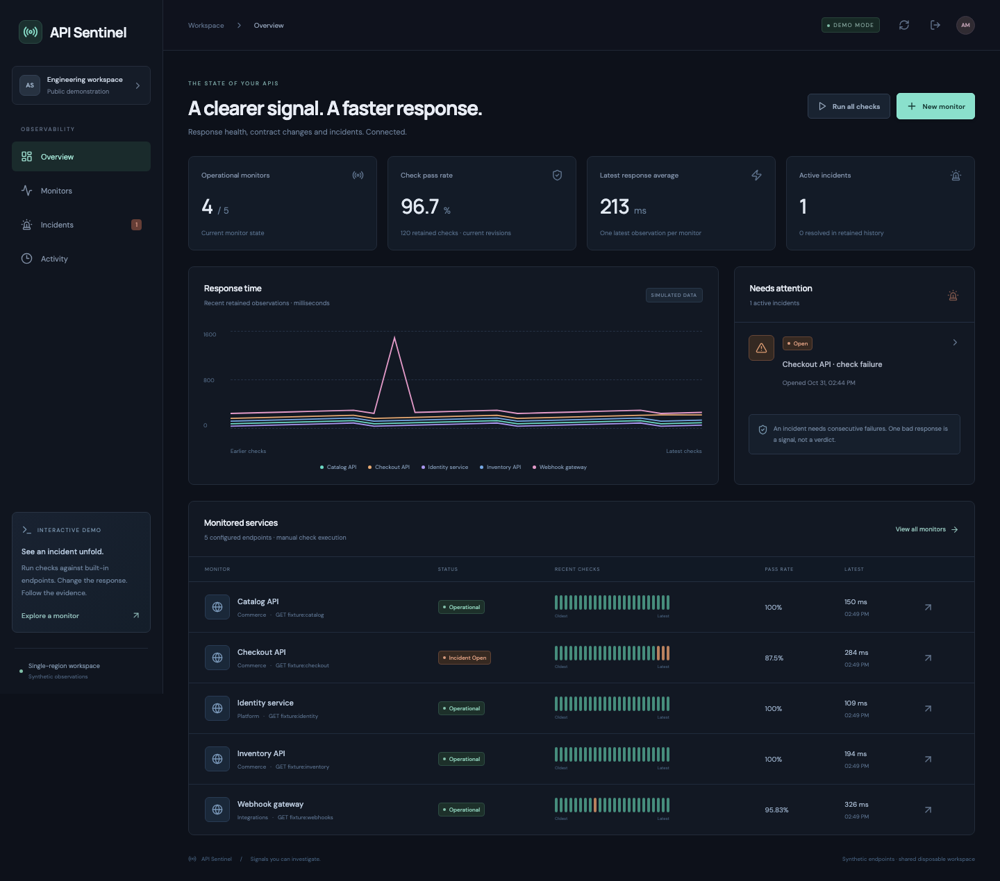

# API Sentinel

[](https://api-sentinel-demo.onrender.com/)

**[Open the live demo](https://api-sentinel-demo.onrender.com/)** · Select **Try the demo**. No account or password needed. The free server may take about a minute to wake. Visitors share synthetic data that resets on restart.

**An API reliability workspace that connects response contracts, check evidence and incident decisions.**

API Sentinel is built with **Node.js 24, TypeScript, Express, SQLite, React and Vite**. It checks HTTP status, response latency and explicit JSON assertions, records response-shape changes, and follows an incident from consecutive failures through acknowledgement to confirmed recovery.

The central design question is whether an observation should change the monitor's current state. A failed request, a configuration edit, a maintenance check and an outdated in-flight result have different meanings; the application preserves those differences in its history.



## Implemented capabilities

- **Response contracts:** expected HTTP status, latency budget, JSON Pointer existence checks, JSON type assertions and primitive-value equality.
- **Response-shape baselines:** capture the first passing response, record added/removed/type-changed paths and explicitly accept a later passing shape as the baseline.
- **Check evidence:** preserve the configuration revision, assertion results, response preview, latency, status, shape and baseline comparison used for each observation.
- **Incident lifecycle:** configurable failure and recovery streaks, one active incident per monitor, operator acknowledgement and retained opening/recovery evidence.
- **Replay safety:** repeated request keys return the original retained check; overlapping requests with the same key share one probe.
- **Concurrency controls:** one in-flight probe per monitor and at most four probes per process.
- **Maintenance and pause:** suppress incident transitions during maintenance; pause blocks new checks and invalidates work that crossed the pause boundary.
- **Configuration revisions:** optimistic edit checks, preserved historical rules and explicit supersession of outdated in-flight results and incidents.
- **Real HTTPS probes in private mode:** public-address DNS validation, pinned connection lookup, TLS verification, bounded response bodies, fixed request deadlines and no redirect following.
- **Recoverable execution:** SQLite jobs, fenced worker leases and durable interval cursors preserve work across private-workspace restarts; the UI exposes attempt history and saved results.
- **Investigation interface:** retained check history, latency traces, pass-rate summaries, incidents, activity and downloadable JSON evidence.
- **Disposable public demo:** built-in endpoints with healthy, HTTP 503, slow and response-drift scenarios, without needing a password or external database.

## Try it locally

Requires **Node.js 24+** and npm.

```sh
npm ci
npm run build
npm start
```

Open **http://127.0.0.1:3400** and select **Try the demo**. Initial data is explicitly synthetic: five monitors, a short generated check history and an open Checkout API incident. Demo latencies are generated observations, not measurements of external services.

### See the incident lifecycle

1. Open **Catalog API** or create a new monitor.
2. Select **Simulate outage**. The application executes the configured number of failing checks; an incident opens when the threshold is reached.
3. Open the monitor's **Incidents** tab, add an investigation note and select **Acknowledge**.
4. Select **Opening evidence** to inspect the original status and failed assertions.
5. Select **Restore service**. After the configured sequence of passing checks, the incident resolves and retains the recovery check.
6. Change **Demo scenario** to **Response shape drift**, then select **Run check** to compare the changed JSON field types with the stored baseline.
7. Enable **Maintenance** to record checks without incident transitions, or pause the monitor to prevent new executions.

## Technology and responsibilities

| Layer | Technology | Responsibility |
| --- | --- | --- |
| Interface | React, TypeScript, Lucide, SVG | Monitor configuration, check review, trends and incident investigation |
| HTTP service | Express, Zod | Validated request contracts, sessions, CSRF and origin checks |
| Probe transport | Node HTTPS, DNS, AbortSignal, ipaddr.js | Address validation, connection pinning, TLS and resource limits |
| Evaluation | TypeScript, JSON Pointer traversal | Status, latency, required paths, types, values and bounded response shapes |
| State and evidence | SQLite, parameterized SQL | Configuration revisions, observations, request identities, incidents and events |
| Scheduling | SQLite jobs and TypeScript workers | Fenced claims, bounded retries, interval cursors and crash recovery |
| Verification | Node test runner, Playwright | State invariants, failure rollback, HTTP behavior and browser workflow |
| Delivery | Docker, GitHub Actions | Reproducible build, automated checks and single-service hosting |

## How check results become incidents

A normal check is **passed** only when all configured assertions pass. Otherwise it is **failed**. An isolated failure resets after a passing check; failures do not accumulate across successful responses.

After `failThreshold` consecutive failures, the monitor opens an incident. More failures update the streak without opening duplicate active incidents. Acknowledgement records an operator note but does not claim recovery. `recoverThreshold` consecutive passing checks resolve the incident and attach recovery evidence.

| Situation | Recorded result | Effect on incident state |
| --- | --- | --- |
| Active monitor, assertions pass | `passed` | Advances recovery streak; resets failures |
| Active monitor, an assertion fails | `failed` | Advances failure streak; resets recovery |
| Maintenance enabled | `suppressed` | Evidence stored; no incident transitions |
| Rules changed while probe ran | `superseded` | Old observation retained; no current-state transition |
| Probe crossed a pause/maintenance boundary | `superseded` | Old observation retained; no current-state transition |
| Monitor paused before execution | Request rejected | No probe or check created |

Entering or leaving maintenance/pause resets streaks. Editing a monitor creates a new configuration revision, resets the baseline and streaks, and resolves an existing incident with the explicit reason **configuration changed / superseded**. That transition does not attach a recovery check or pretend that service recovery was measured.

## Engineering decisions

### Evidence must keep its original meaning

Each check stores its configuration snapshot and version. Editing a latency budget or JSON assertion therefore does not rewrite an older outcome. Baseline comparisons are stored with the check rather than recalculated against whichever baseline is current today.

A control epoch tracks pause/maintenance boundaries independently of configuration versions. A request that started before a pause and finished after resume remains outdated even if the final control flags match their original values.

### Retry safety extends beyond concurrent requests

A `(monitor, request key)` identity is unique in SQL. In-flight calls with the same identity share one probe; a completed identity returns the original retained result. SQL transactions group check evidence, request identity, streak changes, incident transitions and audit events.

After a full check leaves retained history, a small request-key entry remains. Replaying that expired identity returns `410` instead of silently performing another observation. Use a new key when you intend to run a new check.

The test suite injects a storage failure during incident insertion and verifies rollback of the check, key, streak, incident and corresponding event.

### A response can drift without violating the configured contract

The shape baseline records observed JSON types by pointer. A changed type is visible in the report even if no explicit assertion targets that field. Shape drift is informational by itself; it fails a check only when a configured assertion also fails.

Traversal is bounded to five nested levels and 150 shape entries. Arrays use the first element as a representative shape. This is a focused response-shape comparison, not complete JSON Schema or OpenAPI conformance.

### Probe targets need a controlled network boundary

The public demo only uses in-process fixtures. Private mode accepts HTTPS GET endpoints on port 443, without embedded credentials or URL fragments. It rejects loopback, private, link-local, multicast and reserved addresses, including non-public DNS answers and mixed public/private answers. The validated address is pinned into the HTTPS connection lookup while TLS hostname verification remains enabled.

DNS has a two-second deadline; the full probe has a five-second budget. Redirects are not followed, responses are capped at 256 KB, and non-JSON responses become failed observations. No custom authentication headers, cookies or mutation methods are sent.

## Real monitoring in private mode

```sh
PUBLIC_DEMO=false \
DATABASE_PATH=data/sentinel.sqlite \
OPERATOR_PASSWORD='replace-with-a-unique-password-of-16-or-more-characters' \
RUN_SCHEDULER=true \
npm start
```

The private workspace uses a single operator password and persistent local SQLite. Create an HTTPS monitor for a JSON endpoint you are authorized to monitor. Set its interval between 60 and 3,600 seconds.

The worker scans every second. Manual checks and explicit **Queue check** actions use SQLite jobs with recorded attempts, 15-second leases and at most three attempts. Infrastructure failures retry after one and two seconds. A failed HTTP assertion is a completed job with a failed check, not a worker failure.

With `RUN_SCHEDULER=true`, durable interval cursors enqueue one current check after downtime and record the number of missed slots; they do not fabricate historical observations. Configuration revisions and pause epochs cancel stale queued work. Evidence, incident transitions and job completion commit in one fenced transaction: an expired worker cannot commit a second result. An interrupted HTTP GET can be repeated during recovery; this is not exactly-once network delivery.

Set `SEED_DEMO=false` for an empty workspace. `COOKIE_SECURE=true` enables secure cookies behind HTTPS. `APP_ORIGIN` can declare the frontend origin; Render's service URL is recognized through `RENDER_EXTERNAL_URL`. `npm start` loads a local `.env` file when present.

Use one application process for the authenticated workspace because sessions remain process-local. Lease coordination is tested across handles sharing one local SQLite file, not across hosts. Restart recovery requires a persistent `DATABASE_PATH`; free disposable demos use memory and reset on restart. Their manual fixture queue works, but recurring interval scheduling remains disabled. `RUN_SCHEDULER=false` disables intervals, not manual queue processing.

### Inspect queued work

Open a monitor and choose **Queue check → Jobs**, or use **Execution jobs** in navigation. Inspect each attempt and its saved check, filter by state, export history, cancel queued work, or retry a terminal infrastructure failure as a new linked job. Running work cannot be cancelled. Retained job history labels checks whose full evidence has expired.

The queue admits at most four unexpired worker leases, keeps the latest 200 terminal jobs per monitor and returns the latest 100 matching jobs. Attempts are capped at three. It does not send notifications.

## Metrics and retention

- Pass rate is the fraction of retained, current-revision **passed/failed** checks that passed all assertions. It is not time-based uptime.
- p95 in the API uses the nearest-rank percentile of those retained response times. Small samples remain small samples.
- The dashboard's response average uses one latest observation per monitor.
- Charts show retained observations by sequence, not evenly spaced wall-clock time.
- Each monitor retains its latest 200 full checks, plus evidence referenced by retained incidents.
- The workspace retains 100 resolved incidents, current active incidents and 500 activity events.
- Request identities are capped at 10,000 per monitor; the workspace supports up to 20 monitors.

Public-demo data and sessions disappear on process restart. All visitors share the same synthetic workspace. No external database is required for the demo.

## Verify the implementation

```sh
npm test
npm run build
npx playwright install chromium
npm run test:e2e
```

The domain/API suite covers incident thresholds, confirmed recovery, acknowledgement, concurrent replay, configuration edits, pause epochs, maintenance, transaction rollback, shape drift, retained-key behavior, persistence, scheduler intervals, origin checks, CSRF and non-public address rejection.

The browser scenario creates a monitor, opens/acknowledges/resolves an incident, reviews opening evidence, checks response-shape drift, exercises maintenance/pause and downloads the evidence export. Desktop and mobile screenshots are included in `docs/`.

See [verification record](docs/VERIFICATION.md) for the measured local result, [architecture/API notes](docs/ARCHITECTURE.md) for the state model, and [portfolio wording](docs/PORTFOLIO.md) for concise CV/LinkedIn descriptions.

## Scope

The implementation is a focused, single-process monitor for JSON GET endpoints. It does not claim multi-region probes, a multi-tenant account system, distributed scheduling, notification delivery, authenticated upstream APIs, OpenAPI validation, an external database adapter or measured production throughput. [Future work](docs/ROADMAP.md) is documented separately from completed features.
